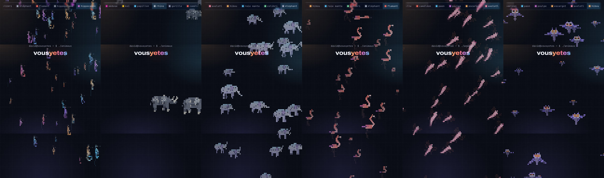
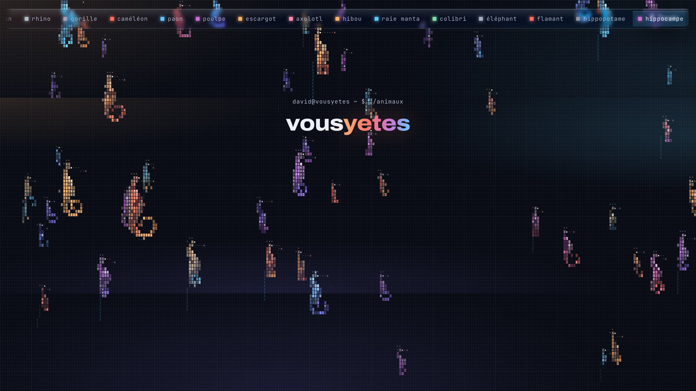

# vousyetes : ascii zoo

<p align="center"></p>

<p align="center"><a href="https://animaux-vy.pages.dev/"><b>Live demo</b></a></p>

Animals drawn as ASCII on a canvas, crossing the screen. The vousyetes version: night-tech look (black background, fine grid, colour arriving as light), 21 animals, a Tweaks panel, and a folding dock with a magnifier effect.

**Added on top of the original seven:** rhino (a nod to Dürer's 1515 woodcut), gorilla, chameleon (one colour at a time that keeps changing, living on long branches), peacock, squid, snail (golden-ratio shell), axolotl, owl, manta ray, hummingbird, elephant (sprays water on click), flamingo, hippo, seahorse, plus a salamander (6 patterns, crickets and tongue flicks on click), fireflies (they sync up, nectar on click) and ants (they carry sugar back to the nest). Everyone reacts to a click in their own way. **Kept from the original:** jellyfish, koi, butterfly (shifted from blue to cyan) and frog.

**Honest state:** elephant, snail, hummingbird, flamingo, axolotl, squid, chameleon, peacock, rhino and seahorse read well. Gorilla and hippo are fine but could be better, the manta is sometimes cut by the edge, and not every click behaviour has been checked. `scripts/shot.mjs` captures one animal in 9:16 to iterate on.

**Inspired by the "Terrarium" prompt:** salamanders, fireflies and ants, and the idea of feeding them with a click.

```sh
npm install && npm run dev
```

<p align="center"></p>

## Credits and license

- Engine and the original seven animals: [ascii-animals](https://github.com/DesignerStephen1/ascii-animals) by Stephen Zhang and drewdi (MIT).
- ascii-animals is itself built on [ascii-sharks](https://github.com/stackedlol/ascii-sharks) by stackedlol (MIT).
- This version is MIT too. The original copyright notices are kept in `LICENSE`.
- Changes by vousyetes: the look, 14 new animals, the interface. The Dia-style chat box and its logo were removed.

---

# Original README (ascii-animals)

# ascii animals

Animals drawn as ASCII on a canvas, crossing the screen along one course. Zero dependencies.

Pick one from the row of animals in the top bar. Dark mode only, and each animal has its own colour:

| Animal | How it moves |
|---|---|
| Butterfly | blue morphos on migration: flutter, zigzag, glide with wings flat |
| Koi | lazy S-curves on bendy spines; kohaku, sanke, showa, ogon and chagoi; tap to drop food and koi close by swim over to eat |
| Jellyfish | bioluminescent magenta: each pulse lights the bell up, then the glow eases out; frilly twisting arms, marine snow (made for dark mode) |
| Dragonfly | emerald hawkers: hover, dart, cruise along for a while; white eyes with black pupils on the nearer ones, a striped green thorax, a dark body banded emerald, clear veined wings with a sweeping glint (made for dark mode) |
| Frog | spotted leopard frogs that sit, breathe and blink, then leap in an arc (bigger at the top), with a splash on landing |
| Crane | red-crowned, after the paintings: each flies its own way along the course, flapping at its own pace and gliding now and then (Folding flap in Tweaks for a slow downstroke and a quick, wrist-folding upstroke); broad white wings with splayed fingers and black secondaries, a red crown, dark eyes on the nearer ones |
| Crab | scuttle sideways in bursts, legs stepping, footprints in the sand; tap and they bolt away, claws up |

Everywhere:

- smaller ones are farther away: they move slower and fade into the background
- whoever leaves downstream comes back in upstream
- **click** to startle the ones nearby (each animal reacts its own way)
- the last animal picked is remembered between visits
- a liquid-glass chat input in the middle, a concept redesign after Dia's AI input (not affiliated with Dia):
  Dia's dome (`public/dia-logo.png`, cut out of a screenshot) and a greeting by the time of day
  ("Still up, Stephen?" after 10pm) above it, then "Ask anything...",
  "Add tabs or files", voice and send (UI only: Enter fires a `chat:submit` event on the form with `{ text }`); the refraction
  uses an SVG filter in Chromium and falls back to frosted glass elsewhere
- a **Tweaks** panel (top right): shared Movement and Look sliders plus each animal's own,
  saved per animal; double-click a label to reset it, **Copy** exports what you changed as JSON

```sh
npm install && npm run dev
```

`?animal=koi` picks an animal, `?count=60` pins how many.

```ts
import { AnimalEngine } from "./src";

const engine = new AnimalEngine(canvas, { animal: "jellyfish", theme: "dark", tuning: { speed: 1.4 } });
engine.setAnimal("cranes");
engine.set("density", 2);
```

## How it's put together

- `src/flock.ts`: the world every animal shares (population, depth, the course, re-entry,
  startle, steering helpers) and the shared knobs
- `src/renderer.ts`: the ASCII renderer and the `Pen` animals draw with (supersampled
  silhouettes, line glyphs, dots, the trail)
- `src/animals/*.ts`: one file per animal: its behaviour, shape, paint and its own knobs
- `src/engine.ts`: the loop, resizing, input and switching animals

## Publishing to Pocket Studio

It's live at [pocketstudio.design/ascii-animals-app](https://pocketstudio.design/ascii-animals-app/index.html),
as a static build inside the studio site ([Sumin-Studio/Studio-site](https://github.com/Sumin-Studio/Studio-site)),
next to the butterflies app. To update it, build with the site's path as the base, straight into
the site's `public/` (here with Studio-site checked out next to this repo):

```sh
npx vite build --base=/ascii-animals-app/ --outDir ../Studio-site/public/ascii-animals-app --emptyOutDir
cp LICENSE ../Studio-site/public/ascii-animals-app/
```

Then commit that in Studio-site and open a PR. Its Pocket Labs card (image, description, the
"Try it out" link) is the `ascii-animals` entry in `components/pocket-labs-data.ts`, with its
images in `public/labs/ascii-animals*`. If a squash merge's production build is blocked because
Vercel doesn't recognise the commit's email, push an empty "Trigger production deploy" commit
to `main` from an email on the Vercel team.

The app keeps its settings in localStorage under `ascii-animals:` keys, so it doesn't pick up
the butterflies app's on the same domain.

Built on the engine and renderer from [ascii-sharks](https://github.com/stackedlol/ascii-sharks). MIT
